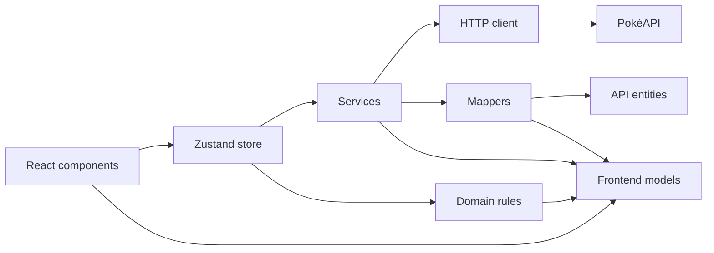

# Pokémon Battle

A small React application that uses the [PokéAPI](https://pokeapi.co/) to create a battle between two randomly selected Pokémon.

Each fighter receives a random move. When the user starts the battle, the application compares the moves' power values and records the outcome in a battle log.

## Live demo

[Play Pokémon Battle on Vercel](https://pokemon-9wjpqc0gc-gustavobpaulas-projects.vercel.app/)

## Features

The core challenge requirements are implemented:

- selects two different Pokémon at random;
- loads each Pokémon's name and moves from the PokéAPI;
- assigns a random move, including its name and power, to each fighter;
- displays the opponent with its front sprite and the player with its back sprite;
- starts the battle through the **Start Battle** button;
- determines the winner using the move with the highest power;
- records the expected knockout message or a draw in the Battle Log.

## Product decisions and extensions

The challenge allows additional functionality after the core flow is complete. This implementation includes the following extensions:

- **Battle history:** the Battle Log keeps the results of previous battles during the current session instead of displaying only the latest result.
- **Contextual draws:** draw messages include both Pokémon names, for example `Draw between Pikachu and Raichu`, so historical entries remain understandable after the fighters change.
- **Change Fighters:** the user can request a new random matchup without reloading the application.
- **Cached Pokémon catalog:** the initial Pokémon list is reused when changing fighters, avoiding repeated requests for the full catalog.
- **Loading feedback:** skeletons represent the arena while the fighters and their moves are being loaded.
- **Display formatting:** API names such as `thunder-shock` are converted to `Thunder Shock` for presentation.

The log is chronological: older battles appear first and new results are appended at the end.

## Technology stack

| Area             | Technology                                          |
| ---------------- | --------------------------------------------------- |
| UI               | React 19, TypeScript 6                              |
| Build tooling    | Vite 8                                              |
| State management | Zustand 5                                           |
| Styling          | Tailwind CSS 4, Base UI and shadcn-style components |
| Data source      | PokéAPI                                             |
| Testing          | Jest, jsdom and React Testing Library               |
| Code quality     | TypeScript and Oxlint                               |

## Architecture

The application uses a layered architecture. PokéAPI contracts are kept separate from the models consumed by the frontend, while battle rules remain independent from React and HTTP concerns.



### Layer responsibilities

- **`entities`** describes the response contracts returned by the PokéAPI.
- **`models`** contains the smaller, frontend-oriented data structures used by the application.
- **`mappers`** converts API entities into frontend models and normalizes presentation data.
- **`services`** performs HTTP requests and orchestrates the creation of a random battle.
- **`domain`** contains battle resolution and random selection rules. `resolveBattle` is a pure function and has no React, Zustand or HTTP dependencies.
- **`store`** coordinates services and domain rules and acts as the source of truth for loading state, fighters and battle history.
- **`components/features`** renders the arena, controls, fighters and Battle Log.
- **`components/ui`** contains reusable visual primitives.

### Project structure

```text
src/
├── components/
│   ├── features/        # Battle-specific UI
│   └── ui/              # Reusable UI primitives
├── domain/              # Battle and random-selection rules
├── entities/            # PokéAPI response contracts
├── mappers/             # Entity-to-model transformations
├── models/              # Frontend data models
├── services/
│   └── core/            # HTTP client and API configuration
├── store/               # Zustand battle state
├── utils/               # General-purpose helpers
├── App.tsx
└── main.tsx
```

## Application flow

1. `App` requests the initial fighters when the screen mounts.
2. The store loads and caches the Pokémon catalog.
3. `createRandomBattle` selects two different Pokémon.
4. The Pokémon details and one random move for each fighter are loaded in parallel.
5. Mappers prepare the player and opponent models, including the correctly oriented sprites.
6. The store exposes the fighters to the UI.
7. Clicking **Start Battle** calls `resolveBattle`.
8. The resulting message is appended to the Battle Log.

## Battle rules and assumptions

- Only the selected moves' `power` values are compared.
- The fighter with the highest power wins.
- Equal power values produce a draw.
- Moves without a numeric power are normalized to `0`.
- HP, accuracy, Pokémon types, status effects and the complete game battle system are intentionally outside the scope of this challenge.
- Random selection uses `Math.random`; battles are intentionally non-deterministic outside tests.

## Getting started

### Prerequisites

- Node.js `^20.19.0` or `>=22.12.0`
- npm

### Installation

```bash
npm ci
```

### Development server

```bash
npm run dev
```

Vite will print the local URL in the terminal, normally `http://localhost:5173/`.

## Available scripts

| Command              | Description                                |
| -------------------- | ------------------------------------------ |
| `npm run dev`        | Starts the Vite development server         |
| `npm run build`      | Type-checks and creates a production build |
| `npm run preview`    | Serves the production build locally        |
| `npm run lint`       | Runs Oxlint                                |
| `npm test`           | Runs the Jest test suite                   |
| `npm run test:watch` | Runs Jest in watch mode                    |

To generate a local coverage report:

```bash
npm test -- --coverage
```

The current tests cover the battle rules, random fighter and move selection, HTTP request behavior, and the main Zustand store transitions.

## API endpoints

The application consumes the following PokéAPI endpoints:

```text
GET https://pokeapi.co/api/v2/pokemon?limit=2000
GET https://pokeapi.co/api/v2/pokemon/{pokemon_name}
GET https://pokeapi.co/api/v2/move/{move_name}
```

No API key or environment variable is required.

## Current scope

- The application targets the latest desktop version of Chrome, as requested by the challenge.
- Battle history is kept in memory and is cleared when the page is reloaded.
- Network failures transition the store to an error state; richer error feedback in the UI would be a natural next improvement.
- Mobile and tablet-specific layouts are not part of the required scope.

## AI assistance disclosure

I used AI-assisted tools to support research, clarify syntax, debug specific issues and improve the documentation. I reviewed and adapted every suggestion before applying it to the project. The product decisions, architecture and final implementation are my responsibility, and I can explain the code, decisions and trade-offs made throughout the development process.
